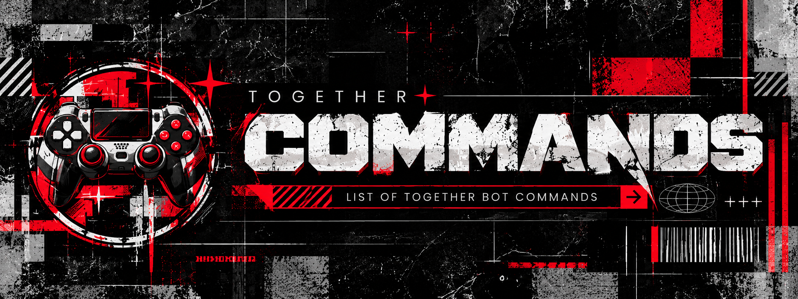
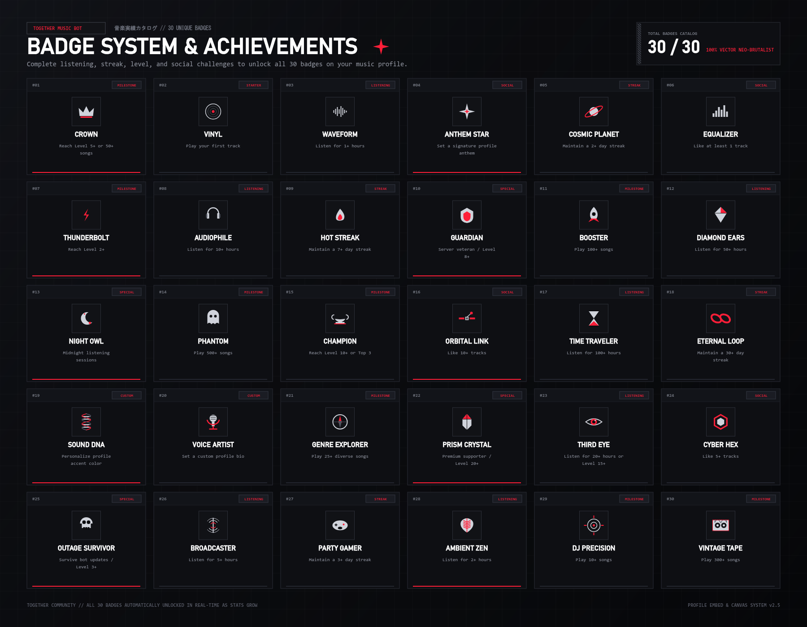
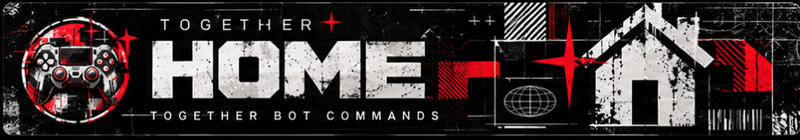
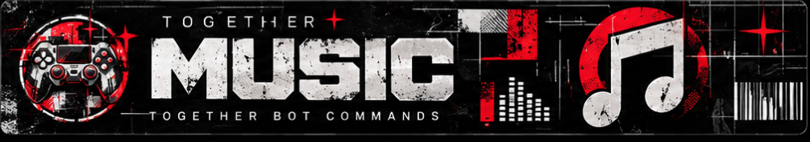
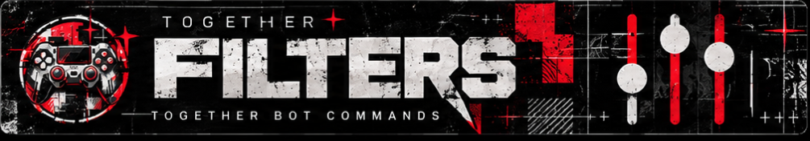
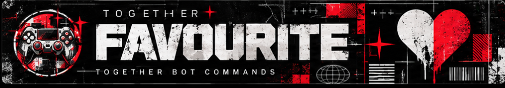
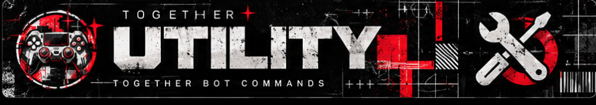
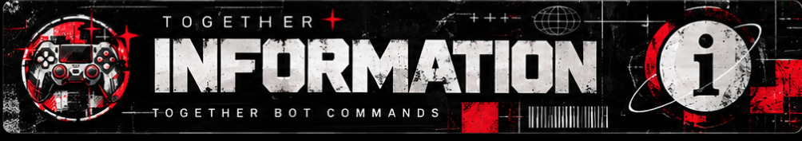
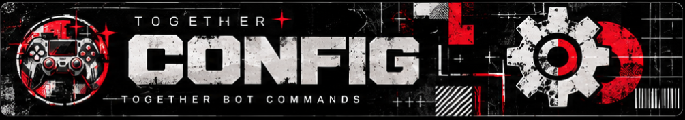

<div align="center">
  
</div>

<div align="center">
  <br />
  
  <h1>TOGETHER</h1>
  <p><strong>Sound that brings us closer.</strong></p>
  <p>A polished, component-first Discord music bot powered by the <strong>Native TOGETHER Audio Engine</strong>, <code>@discordjs/voice</code>, and <strong>FFmpeg</strong>.</p>

  

  <br /><br />

  <p>
    <a href="#-architecture"></a>
    <a href="#-features"></a>
    <a href="#-requirements"></a>
    <a href="#-license--credits"></a>
    <a href="LICENSE.md"></a>
  </p>
</div>

---

## 📖 Table of Contents

- [Overview](#-overview)
- [Key Features](#-key-features)
- [Feature Modules & Commands](#-feature-modules--commands)
  - [Core & Home](#-core--home)
  - [Music Playback](#-music-playback)
  - [DSP Audio Filters](#-dsp-audio-filters)
  - [Favourites & Library](#-favourites--library)
  - [Utility & Voting](#-utility--voting)
  - [Information & Stats](#-information--stats)
  - [Server Configuration](#-server-configuration)
- [Architecture](#-architecture)
- [Requirements](#-requirements)
- [Installation & Setup](#-installation--setup)
- [Configuration (.env)](#-configuration-env)
- [Scripts & Quality Assurance](#-scripts--quality-assurance)
- [Project Layout](#-project-layout)
- [License & Credits](#-license--credits)

---

## 🌟 Overview

**TOGETHER** is engineered to deliver an audiophile-grade music experience directly inside Discord. Built from the ground up to utilize Discord's modern **Components V2** interface, TOGETHER transforms ordinary text channels into sleek, interactive media players.

Equipped with the **Native TOGETHER Audio Engine**, the bot connects directly to voice channels via `@discordjs/voice` and high-performance FFmpeg pipelines—eliminating mandatory external Java server overhead while maintaining full failover capability.

---

## ✨ Key Features

- **🎧 Native TOGETHER Audio Engine:** Direct voice streaming via `@discordjs/voice` and FFmpeg for ultra-low latency, crystal-clear sound, and jitter-free playback.
- **🎛️ Discord Components V2 UI:** Beautiful, interactive now-playing cards with embedded artworks, responsive action rows, dynamic volume controls, and track seek bars.
- **⚡ Dual-Interface Parity:** 68 Prefix commands (`.play`) and 66 Slash commands (`/play`) featuring intelligent search autocomplete and interactive category pagination.
- **🌈 Real-Time DSP Audio Filters:** 13+ studio filters including 8D Audio, BassBoost, Nightcore, Slowed + Reverb, Vaporwave, and Karaoke without playback stutter.
- **💖 Personal Music Library:** Save favorites, inspect listening history, manage custom playlists, and instantly play liked tracks.
- **🗳️ Top.gg Voting Integration:** Built-in lightweight voting server with automatic webhook validation, voter role tracking, and live announcements.
- **✨ Automated Emoji Sync:** Detects transparent high-res UI icons from `assets/emojis/` on boot and automatically registers application emojis into your bot.
- **📡 24/7 Persistent Mode & Auto-Recovery:** Automatic voice connection health monitoring with proactive reconnection and voice-channel status display.

---

## 📦 Feature Modules & Commands

<div align="center">
  
</div>

### 🏠 Core & Home

The core module powers heartbeat monitoring, cluster sharding, voice-connection stabilization, and runtime recovery.

- **Dynamic Startup:** In clustered setups, cluster `0` synchronizes application emojis while downstream clusters wait and inherit the mapped IDs.
- **TUI Bordered Studio Logger:** Clean, box-drawing console interface with detailed diagnostics for commands, voice states, database connections, and system load.

---

<div align="center">
  
</div>

### 🎵 Music Playback

Supports searching and streaming from YouTube, YouTube Music, Spotify, Apple Music, Deezer, and SoundCloud.

| Command | Aliases | Description |
| :--- | :--- | :--- |
| `play <query>` | `p` | Search and stream music from URL or query with interactive player card |
| `pause` | — | Pause current track playback |
| `resume` | `r` | Resume paused track playback |
| `skip` | `s` | Skip to the next track in the queue |
| `forceskip` | `fs` | Force-skip the current track bypassing vote thresholds |
| `skipto <pos>` | `st` | Jump directly to a specific song number in the queue |
| `previous` | `prev` | Play the previously played track |
| `replay` | `restart` | Restart the currently playing track from the beginning |
| `nowplaying` | `np` | Display the interactive Components V2 now-playing interface |
| `queue` | `q` | View current tracklist with interactive pagination |
| `loop <mode>` | `l` | Toggle loop mode (`off`, `track`, `queue`) |
| `shuffle` | `mix` | Randomize the track order in the queue |
| `seek <time>` | — | Seek to a specific timestamp in the track (e.g. `1:30` or `90`) |
| `forward <sec>` | `fwd` | Fast-forward the track by a specified number of seconds |
| `rewind <sec>` | `rw` | Rewind the track by a specified number of seconds |
| `volume <0-100>`| `v`, `vol` | Adjust playback volume level smoothly |
| `autoplay` | `ap` | Toggle smart autoplay for related song recommendations *(Voter Only)* |
| `similar` | — | Search and queue songs closely related to the current track |
| `search <query>`| `find` | Interactive track picker displaying top search results |
| `history` | — | View recently played tracks in the server |
| `grab` | `save` | Send the current song details and artwork to your DMs |
| `lyrics` | `ly` | Fetch synced and static lyrics for the active track *(Voter Only)* |
| `speed <val>` | — | Adjust playback speed rate (`0.5x` to `2.0x`) |
| `sleep <min>` | — | Set a sleep timer to automatically disconnect after specified minutes |
| `clear` | `cq` | Clear all upcoming songs from the queue |
| `remove <pos>` | `rm` | Remove a specific track from the queue |
| `move <from> <to>`| `mv` | Move a song's position inside the queue |
| `join` | `connect`| Summon the bot to your active voice channel |
| `leave` | `dc` | Disconnect the bot from voice and clear queue |
| `leavecleanup` | — | Leave channel and clean up orphaned player state |
| `forcefix` | `fix` | Forcefully rebuild voice connection if Discord stream drops |
| `stop` | — | Stop playback, clear queue, and release voice channel |

---

<div align="center">
  
</div>

### 🎛️ DSP Audio Filters

Transform your listening experience using real-time Digital Signal Processing (DSP) filters. Accessible via `.filter` or `/filter` through an interactive select menu.

| Filter | Effect Description |
| :--- | :--- |
| **8D Audio** | Rotating 360-degree spatial audio simulation across stereo channels |
| **BassBoost** | Dynamic low-frequency enhancement for deep, punchy punch |
| **Deep Bass** | Sub-bass amplification tailored for EDM and electronic tracks |
| **Treble Boost** | Crisp high-frequency boost bringing out vocals and acoustics |
| **Nightcore** | Elevated pitch and increased tempo (1.25x speed) |
| **Daycore** | Lowered pitch and relaxed tempo for a laid-back vibe |
| **Slowed + Reverb** | Atmospheric slowed tempo blended with a lush reverb space |
| **Vaporwave** | Nostalgic slowed-down vintage cassette tape aesthetic |
| **Chipmunk** | High-pitched vocal frequency shift |
| **Karaoke** | Center-channel vocal attenuation for sing-along sessions |
| **Soft** | Mellow, smooth high-cut EQ for study and relaxation |
| **China** | Eastern harmonic resonant scale shaping |
| **Vibrato** | Rapid frequency modulation creating a shimmer effect |
| **Reset Filters** | Instantly return EQ and filters to pristine studio flat sound |

---

<div align="center">
  
</div>

### 💖 Favourites & Library

Keep your favorite tracks saved and ready across servers.

| Command | Aliases | Description |
| :--- | :--- | :--- |
| `like` | `fav` | Save the currently playing song to your personal library |
| `unlike` | `unfav` | Remove a song from your personal favorites |
| `likeall` | — | Save every song currently in the queue to your library |
| `showliked` | `favorites`| View your saved songs list with interactive pagination |
| `playliked` | `plfav` | Instantly load and stream your saved favorites into the queue |
| `playlist` | `pl` | Manage and play custom named playlists |

---

<div align="center">
  
</div>

### 🛠️ Utility & Voting

Engage with your server community and support the bot on Top.gg.

| Command | Aliases | Description |
| :--- | :--- | :--- |
| `vote` | — | Get the official Top.gg voting link and check your voter status |
| `avatar [user]` | `av` | Display full-resolution user avatar |
| `banner [user]` | — | Display high-resolution user profile banner |
| `servericon` | `icon` | View current Discord server icon in maximum fidelity |
| `serverbanner` | — | View server splash or banner image |
| `membercount` | `mc` | Show member, bot, and online statistics for the server |

---

<div align="center">
  
</div>

### ℹ️ Information & Stats

Live diagnostics, system performance metrics, and detailed user profiles.

| Command | Aliases | Description |
| :--- | :--- | :--- |
| `help [command]` | `h` | Interactive Components V2 help browser with category select menus |
| `ping` | — | Measure WebSocket heartbeat and audio dispatch latency |
| `stats` | `botinfo` | Display cluster memory, active voice connections, guilds, and uptime |
| `profile [user]` | `userinfo` | Showcase musical statistics, listening time, and rank |
| `lb` | `leaderboard` | View top listeners and most active music servers |
| `invite` | — | Generate an OAuth2 bot invite link with recommended permissions |
| `support` | — | Get the official community support server link |

---

<div align="center">
  
</div>

### ⚙️ Server Configuration

Tailor the bot's behavior to match your server's exact community rules.

| Command | Description |
| :--- | :--- |
| `247` | Toggle 24/7 mode to keep bot in voice channel indefinitely *(Voter Only)* |
| `setprefix <prefix>` | Change the custom command prefix for your server (default: `.`) |
| `source <source>` | Set preferred default search platform (`youtube`, `spotify`, `jiosaavn`) |
| `ignore <channel>` | Ignore commands in designated text channels |

---

## 🏗️ Architecture

```
                               ┌─────────────────────────────────┐
                               │         Discord Gateway         │
                               └──────────────┬──────────────────┘
                                              │ Events / Slash
                                              ▼
                             ┌───────────────────────────────────┐
                             │          TOGETHER Client          │
                             │ (Clusters, Commands, Components)  │
                             └────────────────┬──────────────────┘
                                              │
                      ┌───────────────────────┴───────────────────────┐
                      ▼                                               ▼
         ┌─────────────────────────┐                     ┌─────────────────────────┐
         │ Native Audio Engine     │                     │     MongoDB Database    │
         │ - @discordjs/voice      │                     │ - Guild Settings        │
         │ - FFmpeg Realtime DSP   │                     │ - User Playlists        │
         │ - play-dl Streamers     │                     │ - 24/7 Configurations   │
         └─────────────────────────┘                     └─────────────────────────┘
```

- **Voice Layer:** `@discordjs/voice` with native UDP audio sockets.
- **Transcoding:** `ffmpeg-static` handling volume scaling, EQ modulation, and stream normalization.
- **Failover:** Support for Lavalink nodes if enterprise cluster offloading is configured.

---

## 📋 Requirements

- **Node.js:** `v20.18.1` or higher
- **MongoDB:** `v6.0+` (local instance or MongoDB Atlas)
- **Discord Bot Token:** Application with **Server Members**, **Presence**, and **Message Content** privileged intents enabled
- **Bot Permissions:**
  - `View Channels`, `Send Messages`, `Embed Links`, `Attach Files`
  - `Connect`, `Speak`, `Use Voice Activity`
  - `Set Voice Channel Status` *(for real-time now-playing channel text)*

---

## 🚀 Installation & Setup

### 1. Clone the Repository

```bash
git clone https://github.com/0xSHARON/TOGETHER.git
cd TOGETHER
```

### 2. Install Dependencies

```bash
npm install
```

### 3. Configure Environment

Copy `.env.example` to `.env`:

```bash
cp .env.example .env
```

Open `.env` and supply your credentials:

```dotenv
# Bot Token & Identification
BOT_TOKEN=your_discord_bot_token_here
OWNER_IDS=your_discord_user_id
BOT_PREFIX=.
BOT_COLOR=#3F4652

# Database
MONGODB_URL=mongodb://127.0.0.1:27017/TOGETHER

# Optional Spotify Metadata
SPOTIFY_CLIENT_ID=your_spotify_client_id
SPOTIFY_CLIENT_SECRET=your_spotify_client_secret

# Top.gg Voting (Optional)
VOTE_PORT=5000
VOTE_CHANNEL_ID=your_vote_notification_channel_id
```

### 4. Start TOGETHER

```bash
npm start
```

*Note: On first startup, the bot checks `assets/emojis/` and uploads any missing custom emojis directly to your Discord application.*

---

## 🔧 Configuration (.env)

| Variable | Required | Description |
| :--- | :---: | :--- |
| `BOT_TOKEN` | **Yes** | Your Discord Bot Token from Discord Developer Portal |
| `OWNER_IDS` | **Yes** | Comma-separated list of Bot Owner Discord IDs |
| `MONGODB_URL` | **Yes** | MongoDB Connection URI (`mongodb://...`) |
| `BOT_PREFIX` | No | Default prefix for legacy text commands (Default: `.`) |
| `BOT_COLOR` | No | Default hex color for cards and embeds (Default: `#3F4652`) |
| `SPOTIFY_CLIENT_ID` | No | Spotify API Client ID for playlist scraping |
| `SPOTIFY_CLIENT_SECRET` | No | Spotify API Client Secret |
| `TOTAL_SHARDS` | No | Number of shards to spawn or `auto` |
| `SHARDS_PER_CLUSTER` | No | Number of shards per process worker (Default: `4`) |
| `VOTE_PORT` | No | Port for Top.gg webhook server (Default: `5000`) |
| `VOTE_CHANNEL_ID` | No | Discord Channel ID where vote announcements are posted |
| `TOPGG_WEBHOOK_AUTH` | No | Webhook authentication password configured on Top.gg |

---

## 🧪 Scripts & Quality Assurance

```bash
# Validate JavaScript syntax across all modules
npm run check

# Run automated tests on player cards and UI formatters
npm test

# Purge obsolete guild-scoped commands after migration
npm run clear:guild-commands

# Provision dedicated voice channels and stage configurations
npm run setup:channels
```

---

## 📁 Project Layout

```
TOGETHER/
├── assets/
│   ├── banner.png          # Official high-resolution header banner
│   ├── logo.png            # Official bot mascot & avatar
│   ├── badges.png          # Official promotional feature badges
│   ├── banners/            # Feature module headers (Music, Filters, etc.)
│   └── emojis/             # 50+ custom UI icons auto-synced to Discord
├── src/
│   ├── commands/           # Prefix & Slash command implementations
│   │   ├── Config/         # Server prefix, source, 24/7 settings
│   │   ├── Favourite/      # Likes, saved tracks, playlist handling
│   │   ├── Filters/        # DSP real-time sound effects
│   │   ├── Information/    # Help menu, stats, ping, leaderboard
│   │   ├── Music/          # Playback, queues, controls, seeking
│   │   ├── Owner/          # Diagnostic & developer-only tools
│   │   └── Utility/        # Avatar, banner, Top.gg voting
│   ├── events/             # Discord client & player lifecycle hooks
│   ├── loaders/            # Dynamic command, event & component loaders
│   ├── schema/             # MongoDB Mongoose schemas
│   ├── structures/         # NativePlayerManager, NativePlayer, TogetherStreamer
│   └── utils/              # Player cards, TUI logger, emoji synchronizer
├── devrock.js              # Sharding manager and process supervisor
├── package.json            # Dependencies and npm scripts
└── LICENSE.md              # Custom Credit Protection License
```

---

## 📜 License & Credits

### 👑 Created & Developed by **0xSHARON**

This project is governed by the terms specified in [LICENSE.md](LICENSE.md).

> [!IMPORTANT]
> **Credit Protection Notice:**  
> You are permitted to use, modify, and host this bot for personal and non-commercial purposes. **You are strictly prohibited from removing, altering, or obscuring the developer credit (`developed by 0xSHARON`)** in command footers, interactive menus, banners, or project metadata.

<div align="center">
  <sub>TOGETHER • Sound that brings us closer. © 2026 0xSHARON. All rights reserved.</sub>
</div>